<div align="center">

# 百工集 · 汽修耗材 CRM

**把「线索 → 客户 → 商机 → 合同 → 回款」串成一条可追踪的链路**

一套面向汽修耗材经销场景的轻量级客户管理系统：**22 个业务模块 · 8 张数据表 · 26 个 REST 接口 · 纯单机可跑**

<a href="#快速开始"></a>
<a href="#技术栈"></a>
<a href="#技术栈"></a>
<a href="#技术栈"></a>
<a href="#技术栈"></a>
<a href="#技术栈"></a>
<a href="#技术栈"></a>

</div>

<p align="center">
  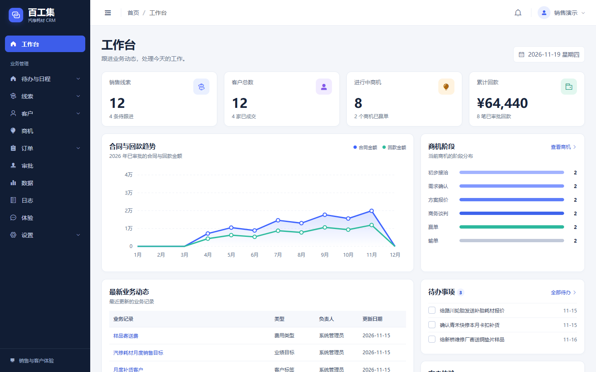
</p>

---

## 它解决什么问题

汽修耗材生意的痛点不在"没客户"，而在**客户散在业务员手里、单据散在微信群里**：

| 传统做法 | 这套系统 |
| --- | --- |
| 线索记在个人备忘录，人走了就断了 | **线索池 / 公海池**：领取、退回、转化全程留痕，客户归属公司 |
| 合同、回款、发票三张表各记一份 | 单据挂在合同下，**单级审批**推进，累计金额自动校验 |
| 谁能看什么客户全凭口头约定 | **部门 → 角色 → 员工** 三级权限，模块级 + 操作级双重控制 |
| 月底靠手工汇总回顾 | 工作台实时看板 + 合同回款月度趋势 + 商机阶段分布 |

---

## 界面速览

<table>
<tr>
<td width="50%"><b>登录</b><br>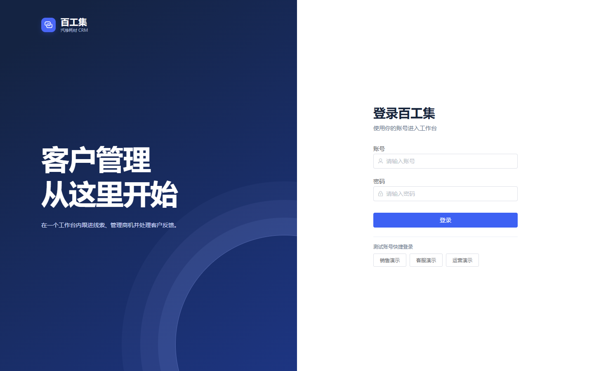</td>
<td width="50%"><b>工作台</b><br></td>
</tr>
<tr>
<td><b>销售线索</b><br>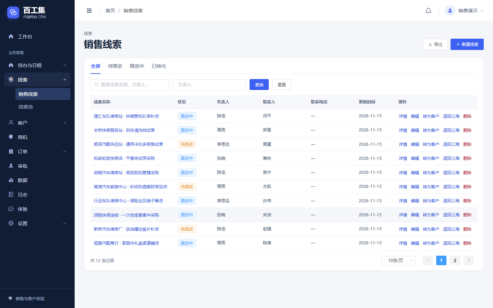</td>
<td><b>客户管理</b><br>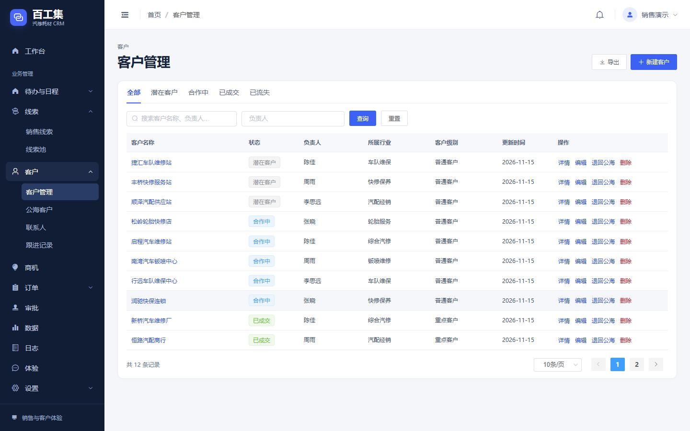</td>
</tr>
<tr>
<td><b>商机管理</b><br>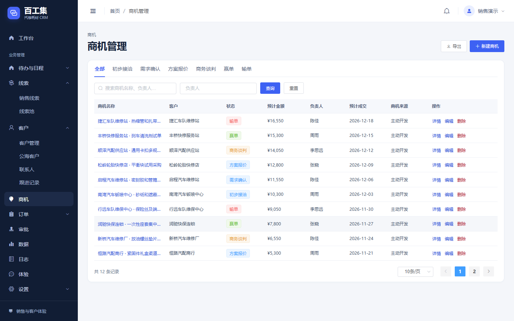</td>
<td><b>合同管理</b><br>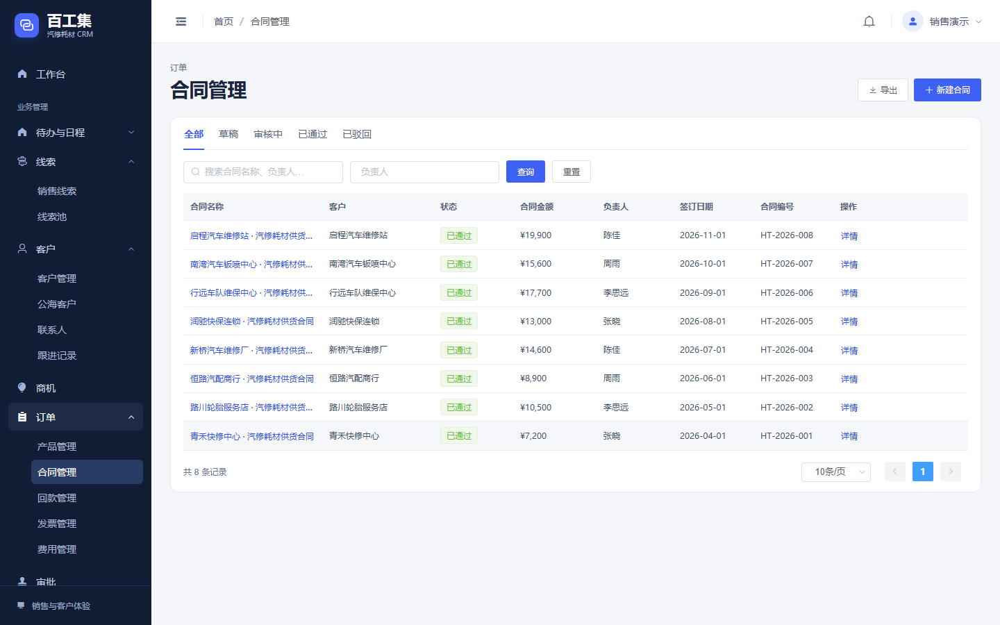</td>
</tr>
<tr>
<td><b>审批中心</b><br>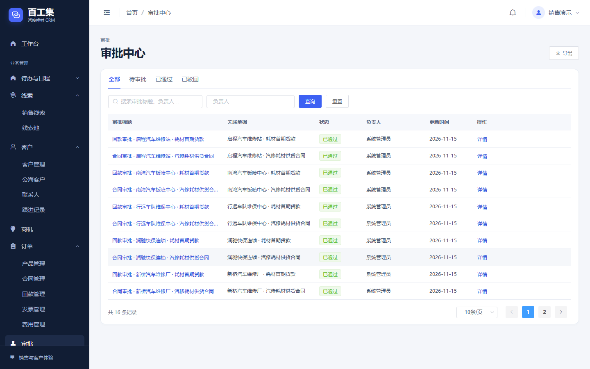</td>
<td><b>数据报表</b><br>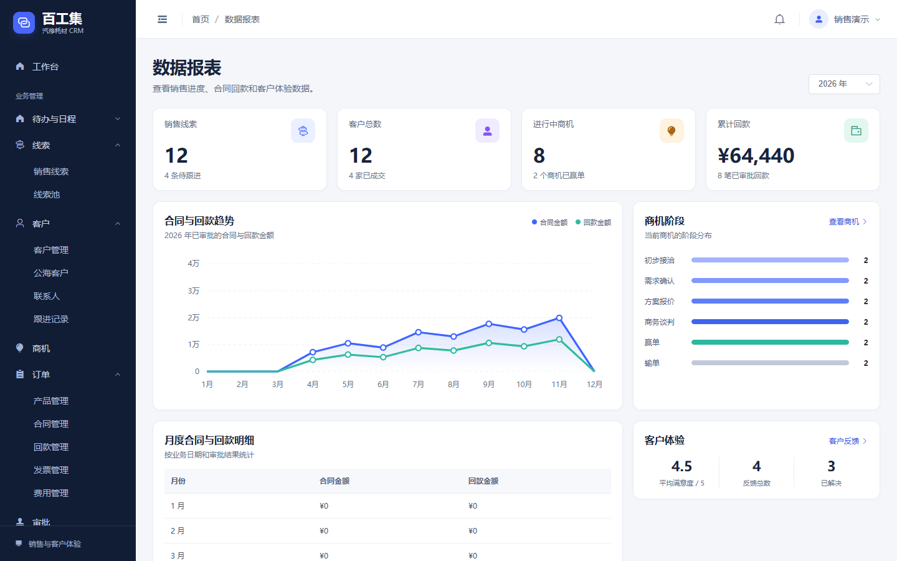</td>
</tr>
<tr>
<td><b>客户反馈</b><br>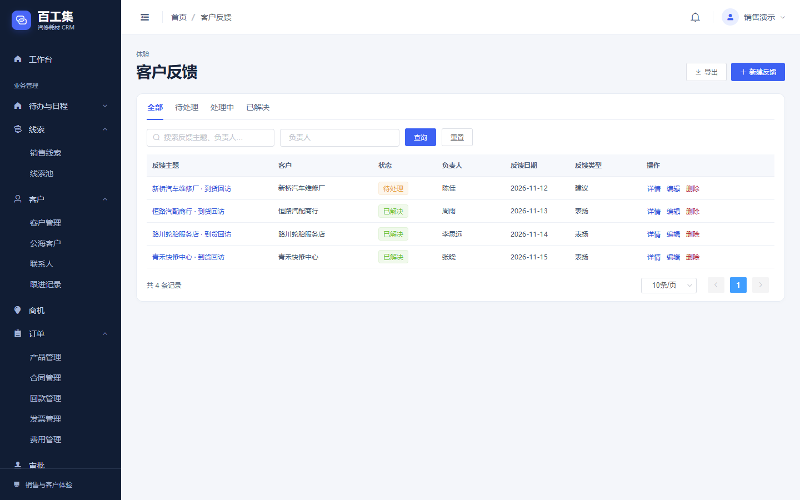</td>
<td><b>联系人</b><br>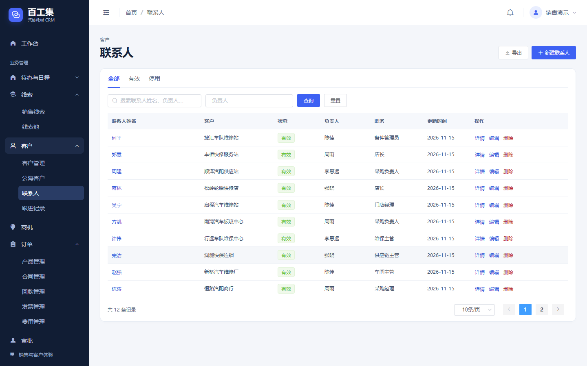</td>
</tr>
</table>

> 截图取自系统内置的演示数据集（销售演示账号），企业名与金额均为虚构样例。

---

## 架构

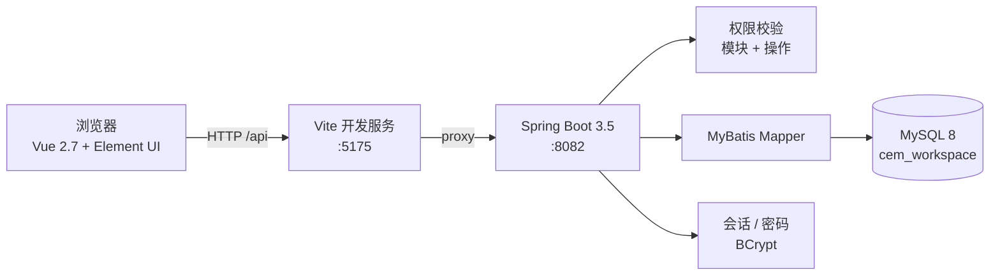

三层职责很干净：**前端只做展示与交互**，**后端独占所有权限判定**，前端菜单按接口返回的权限动态渲染，绕不过服务端。

业务数据走一张统一表：

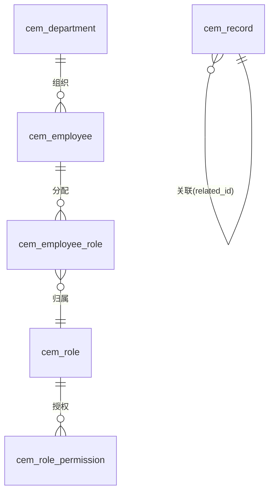

---

## 技术栈

| 层 | 技术 | 说明 |
| --- | --- | --- |
| 前端 | Vue 2.7.16 + Element UI 2.15.14 | 保留 Options API，不引入状态库，页面级组件直连 API |
| 构建 | Vite 6.4.3 + @vitejs/plugin-vue2 | `/api` 代理到 8082，开发与预览同端口 5175 |
| 后端 | Spring Boot 3.5.16 + Java 17 | REST + 内嵌 Tomcat，未引入 Spring Security 全家桶，仅用 crypto 做 BCrypt |
| 持久层 | MyBatis 3.0.5 + MySQL 8 | 手写 SQL，`map-underscore-to-camel-case` |
| 存储 | 单库 `cem_workspace` | 启动时 `schema.sql` 自动建表，幂等 |

---

## 快速开始

**环境要求**：Java 17、Maven 3.9+、Node.js 18+、MySQL 8.0（默认 `127.0.0.1:3306`，`root` / `123456`）

### 1. 启动后端

```powershell
mvn.cmd -f backend/pom.xml clean package
java -jar backend/target/cem-server-1.0.0.jar
```

首次启动会自动创建 `cem_workspace` 库、8 张表、管理员账号和演示数据。健康检查：

```powershell
curl http://127.0.0.1:8082/api/health
# {"status":"up"}
```

### 2. 启动前端

```powershell
cd frontend
npm.cmd ci
npm.cmd run dev
```

### 3. 打开系统

访问 **http://127.0.0.1:5175**，用 `admin` / `admin123` 登录；登录页还提供**销售、客服、运营**三个一键演示账号，无需输入密码即可体验不同角色视角。

> 构建产物：`npm.cmd run build`；本地预览：`npm.cmd run preview`（同样监听 5175，与开发服务不要同时运行）。

---

## 配置

启动后端时用环境变量覆盖，无需改代码：

| 变量 | 用途 | 默认值 |
| --- | --- | --- |
| `DB_HOST` | MySQL 地址 | `127.0.0.1` |
| `DB_PORT` | MySQL 端口 | `3306` |
| `DB_USER` | MySQL 用户 | `root` |
| `DB_PASSWORD` | MySQL 密码 | `123456` |
| `CEM_ADMIN_PASSWORD` | 初始化管理员密码 | `admin123` |
| `CEM_DEMO_DATA` | 是否写入演示数据与快捷登录账号 | `true` |

**投产前必做**：设 `CEM_DEMO_DATA=false` 并重启，关闭快捷登录与演示记录；否则登录页会暴露测试入口。演示数据只初始化一次，要重来需删除数据库后重启。

---

## 功能清单

| 模块组 | 能力 |
| --- | --- |
| **工作台** | 关键指标看板、待办事项、日程管理、最新业务动态 |
| **线索** | 销售线索（筛选 / 分页 / CSV 导出）、线索池、领取、退回公海、转化为客户 |
| **客户** | 客户档案、公海客户、联系人、跟进记录 |
| **商机** | 关联客户、推进阶段（初步接洽 → 需求确认 → 方案报价 → 商务谈判 → 赢单 / 输单）、预计成交日期与金额 |
| **订单** | 产品、合同、回款、发票、费用，单据间金额联动校验 |
| **审批** | 审批中心：提交单据、通过、填意见驳回，单据状态同步回写 |
| **数据** | 合同与回款月度趋势、商机阶段分布、客户体验指标 |
| **日志** | 工作内容与后续计划 |
| **体验** | 客户反馈登记、处理结果记录、满意度评价 |
| **设置** | 员工、部门、角色与权限、公告、客户标签、业绩目标、费用类型字典 |

统一交互：列表分页 + 条件筛选 + 详情抽屉 + CSV 导出；合同、回款、发票、费用走单级审批，回款与发票提交前校验合同审批状态与累计金额。

---

## 权限模型

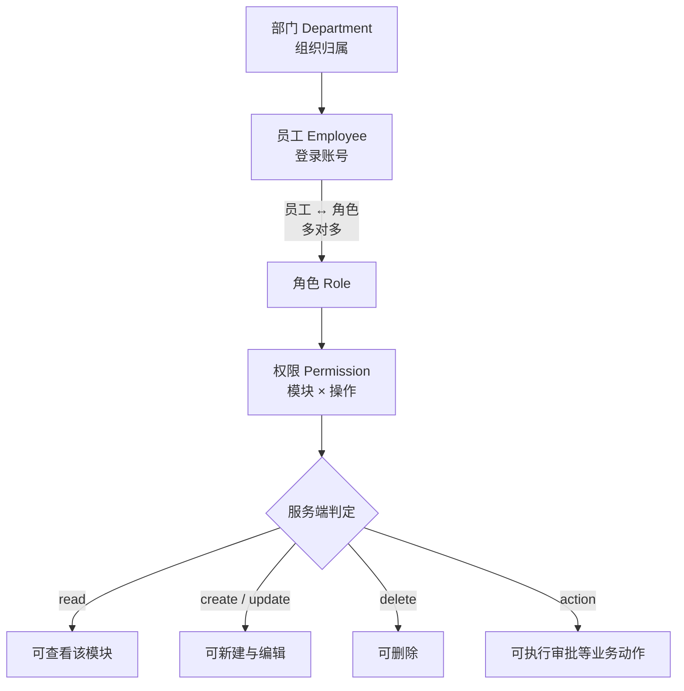

- 一个员工可挂多个角色，**权限取并集**
- 前端菜单依据 `/api/modules` 返回结果渲染，无权限的模块不出现
- 同一模块内的业务记录，对拥有 `read` 权限的人共享可见
- 管理员可停用员工、重置密码；被影响的账号需重新登录

---

## 数据模型

| 表 | 职责 |
| --- | --- |
| `cem_user` | 登录凭证（BCrypt 散列、会话绑定） |
| `cem_employee` | 员工档案、部门归属、启停状态 |
| `cem_department` | 组织树（销售 / 供应链 / 生产 / 质量技术 / 财务行政预置） |
| `cem_role` / `cem_role_permission` / `cem_employee_role` | 角色、授权矩阵、人员绑定 |
| `cem_record` | **所有业务记录的统一载体** |
| `cem_initialization` | 初始化标记，保证建库与演示数据只执行一次 |

`cem_record` 用 `kind` 区分 22 类业务对象（`leads`、`contracts`、`payments`…），公共字段建索引，各模块差异字段进 `details` JSON，并通过 `related_id` 自关联形成"客户 → 商机 → 合同 → 回款"的实体链：

```sql
kind         VARCHAR(32)   -- 模块标识，如 contracts
status       VARCHAR(24)   -- 状态机取值
owner        VARCHAR(80)   -- 负责人
related_id   BIGINT        -- 自关联上游记录
amount       DECIMAL(16,2) -- 金额（可空）
due_date     DATE          -- 关键日期（可空）
details      JSON          -- 模块专属字段
```

**为什么这么设计**：22 个模块如果各建一表，新增字段就要改表结构、改 Mapper、改前端三处；统一记录表把"新增一个业务模块"降级为配置一条 `modules.json`。代价是数据库层不做强类型约束，字段校验全部由应用层承担——对内部系统而言，这个交换是划算的。

---

## 接口

所有接口以 `/api` 为前缀，除 `/health`、`/login`、`/demo-accounts` 外均需会话。

| 分组 | 接口 |
| --- | --- |
| 会话 | `GET /me`、`POST /login`、`POST /logout`、`POST /password`、`GET /demo-accounts`、`POST /demo-accounts/login` |
| 元数据 | `GET /modules`、`GET /health` |
| 业务记录 | `GET /records/{kind}`、`GET /records/{kind}/{id}`、`POST /records/{kind}`、`PUT /records/{kind}/{id}`、`DELETE /records/{kind}/{id}`、`POST /records/{kind}/{id}/actions` |
| 看板 | `GET /dashboard`、`GET /reports` |
| 组织 | `POST/PUT/DELETE /departments`、`POST/PUT/DELETE /roles`、`POST/PUT /employees`、`PUT /employees/{username}/password` |

`actions` 是状态机入口：审批通过 / 驳回、单据提交、线索领取与退回，都收敛到这一个接口，避免为每种流转单独开路由。

---

## 目录结构

```text
.
├── backend/
│   ├── pom.xml
│   └── src/main/
│       ├── java/com/cem/
│       │   ├── CemApplication.java    # 启动入口
│       │   ├── Api.java               # 业务与会话接口
│       │   ├── OrganizationApi.java   # 员工/部门/角色接口
│       │   ├── Workspace.java         # 看板与报表聚合
│       │   ├── Organization.java      # 权限与组织逻辑
│       │   ├── CrmMapper.java         # 记录读写
│       │   ├── OrganizationMapper.java
│       │   ├── ApiErrors.java         # 统一异常出口
│       │   └── DemoData.java          # 演示数据生成
│       └── resources/
│           ├── application.yml
│           ├── schema.sql             # 8 张表
│           └── modules.json           # 22 个模块注册表
├── frontend/
│   ├── vite.config.js
│   └── src/
│       ├── App.vue                    # 登录态、导航、hash 路由
│       ├── Dashboard.vue              # 工作台与报表
│       ├── Records.vue                # 通用业务列表/详情
│       ├── OrganizationSettings.vue   # 员工/部门/角色
│       └── api.js                     # fetch 封装 + 401 处理
└── docs/screenshots/                  # README 配图
```

---

## 常见问题

**登录后立刻被踢回登录页**
会话 8 小时过期，接口返回 401 时前端广播 `cem-session-expired` 并清理本地状态，重新登录即可。

**5175 端口被占用**
在 `vite.config.js` 里改端口即可，前端请求走 Vite 代理，不涉及跨域配置。

**演示数据只出现一次**
`cem_initialization` 表记录了初始化标记。想重建：`DROP DATABASE cem_workspace;` 后重启后端。

**想关掉演示账号但保留自己的数据**
设 `CEM_DEMO_DATA=false` 重启即可，已有业务记录不受影响，只是登录页不再出现快捷入口。

**中文文件名在 git 里显示成八进制**
`git config --global core.quotepath false`

---

## 后续规划

- [ ] 单元测试与接口契约测试（当前仅有手工验证）
- [ ] 通用 CSV 导入（现在只支持导出）
- [ ] 单据附件上传与版本留痕
- [ ] 移动端适配（侧边栏折叠已在 ≤560px 生效）
- [ ] `docker compose up` 一键起 MySQL + 后端 + 前端

---

## 说明

- 系统参考 [AxureShop 公开原型](https://www.axureshop.com/a/2221882.html) 的业务结构实现，界面与交互为本项目独立设计。
- 所有演示数据（企业名、金额、联系人）均为虚构，不涉及真实客户信息。
- 本项目为内部使用，未附带开源许可，转载或商用请联系作者。
